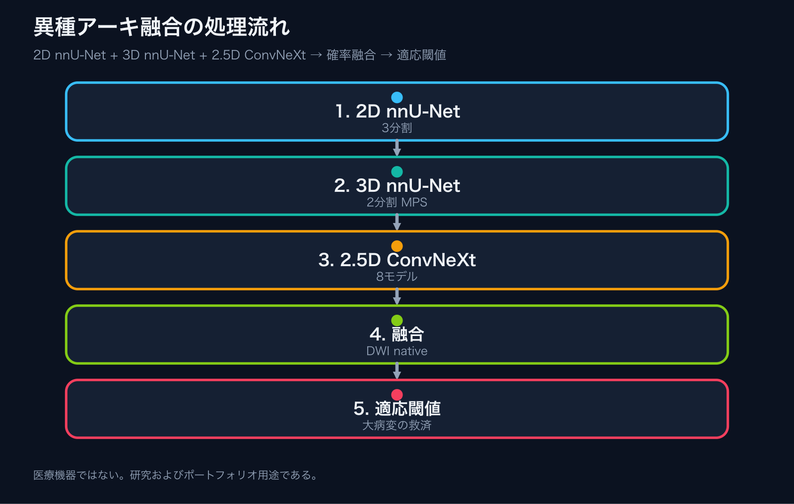
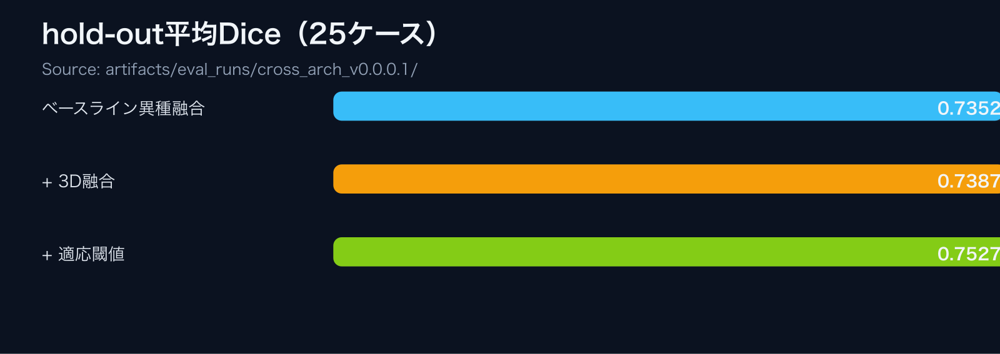

# isles2022-2d3d-blend-reproducible-pipeline

**言語:** 日本語 | [英語版](README.md)

本リポジトリは、ISLES 2022 急性期脳梗塞病変セグメンテーション向けの異種アーキテクチャ融合パイプラインを公開する。2D nnU-Net（3 fold）、MPS 互換 3D nnU-Net（2 fold）、2.5D ConvNeXt（8 モデル）を DWI native 空間で確率融合し、過小予測された大病変を救済するケース適応的閾値処理を組み合わせる。

> 研究およびポートフォリオ提示を目的とする。**医療機器ではありません。** 医療データ本体は公開物に含めない。

**関連リンク**

- 入口（EN）: [isles2022_2d3d_blend/README_en.md](isles2022_2d3d_blend/README_en.md)
- 入口（JA）: [isles2022_2d3d_blend/README.md](isles2022_2d3d_blend/README.md)
- 実験経緯: [docs/experiment_journey_ja.md](docs/experiment_journey_ja.md)
- ケース別評価: [artifacts/eval_runs/cross_arch_v0.0.0.1/](artifacts/eval_runs/cross_arch_v0.0.0.1/)
- モデルカード: [MODEL_CARD.md](MODEL_CARD.md)
- 重み配布: [docs/weights.md](docs/weights.md)
- リリースノート: [docs/releases/v0.0.0.1_ja.md](docs/releases/v0.0.0.1_ja.md)
- 監査マップ: [AUDIT_MAP.md](AUDIT_MAP.md)
- 引用: [CITATION.cff](CITATION.cff)
- 公開整備チェック表: [docs/audit/polish-isles2022-2d3d-blend.md](docs/audit/polish-isles2022-2d3d-blend.md)

## 処理構成

<p align="center"></p>

<p align="center"></p>

## 本リポジトリで確認できること

- 2D、3D、2.5D を組み合わせた再現可能な異種アンサンブル手順
- MPS 互換の 3D nnU-Net 学習（`ConvTranspose3d` 未対応への回避）
- CC-overlap rescue 付きの異種確率融合
- ケース適応的閾値（大病変の過小セグメンテーション救済。小病変には影響しない）
- 実データなしの smoke test

## 主要結果

ISLES 2022 の 25 ケース独自 hold-out 分割における平均 Dice は次のとおりである。

| 構成 | mean Dice |
|---|---:|
| ベースライン（8× ConvNeXt 2.5D + 2D nnU-Net 3-fold） | 0.7352 |
| + 3D nnU-Net 2-fold 融合（2D 60% / 3D 40%） | 0.7387 |
| + 適応閾値後処理 | **0.7527** |

適応閾値は、基底閾値での予測体積が 4000 voxel を超えるケースでのみ低閾値へ切り替える。25 ケース中 2 ケースのみが変化し、残り 23 ケースは不変である。平均 Dice の純増は +0.014 である。

> 出典は `artifacts/eval_runs/cross_arch_v0.0.0.1/` である。研究実装であり、**医療機器ではありません**。

## 最終レシピ

```
nnUNet 確率 = 0.6 × 2D-3fold 平均 + 0.4 × 3D-2fold 平均 (fold 0,1)
combined    = 0.20 × ConvNeXt-8 平均 + 0.80 × nnUNet 確率
rescue      = alpha=0.7, case_gate_agree=0.4, cc_min_overlap=20
post-proc   = base_thr=0.30 → 予測体積 > 4000 のとき 0.03 で再閾値化
```

## 医療データを用いず動作を確認する手順

```bash
python scripts/smoke_test.py --use_dummy_data
```

```bash
cd core/pipeline
python tools/make_manifest.py
```

## 公開範囲

含むもの: ソース、MPS 用 trainer、設定、監査・再現性文書、静的図。

含めないもの: `Datasets/`、学習済み重み（`*.pt` / `*.pth`）、`runs/`、`results/`、`logs/`。

## 引用

[CITATION.cff](CITATION.cff) に従う。

## ライセンス

Apache License 2.0。[LICENSE](LICENSE) および [NOTICE](NOTICE) を参照する。
